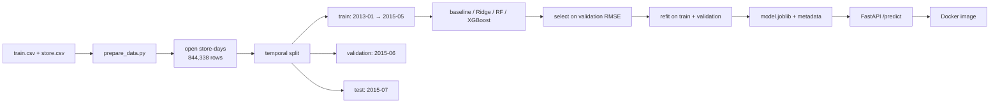

# Rossmann Daily Sales Forecasting

Predict daily sales for **1,115 Rossmann stores** from calendar, promotion, holiday, and static store features — then serve the forecast through a FastAPI endpoint in Docker.

This is the midterm project for [ML Zoomcamp 2026](https://github.com/DataTalksClub/machine-learning-zoomcamp). It applies modules 1–6: problem framing, regression, evaluation, deployment, and tree-based models.

---

## The problem

Rossmann store managers need a next-day / next-week sales forecast to plan staffing, stock, and promotions. A forecast that is off by €1,000 per store-day is operationally expensive: too much staff wastes payroll, too little loses sales.

**Business question:** given a store and a date, what daily sales should we expect?

**Who uses it:** a store-operations dashboard or a planning API. The output is a point forecast in the same units as `Sales` (euros), with the model’s test error stated up front.

**Success metric:** RMSE and MAE on **open store-days**, evaluated on a **future month** the model never saw. A store-median baseline establishes the floor.

---

## Dataset

| Item | Value |
|---|---|
| Source | [Rossmann Store Sales (Kaggle)](https://www.kaggle.com/competitions/rossmann-store-sales), mirrored on [Hugging Face](https://huggingface.co/datasets/AiiN-aini/rossmann-store-sales) |
| Raw rows | **1,017,209** store-days × 9 columns, plus 1,115 store records |
| Raw period | 2013-01-01 → 2015-07-31 |
| Units | 1,115 stores; daily sales; `Open`, `Promo`, `StateHoliday`, `SchoolHoliday` |
| Target | `Sales` |
| Modeling rows | **844,338** open store-days (172,871 closed/zero-sales rows removed) |
| Store metadata | store type, assortment, competition distance/open date, `Promo2` participation |

The raw files are not committed. `prepare_data.py` downloads them, verifies SHA-256, and rebuilds the processed table:

```bash
make data        # or: uv run python prepare_data.py
```

The committed `data/processed/rossmann.parquet` (4.3 MB) means reviewers can run training without downloading anything.

**License:** the data comes from a Kaggle competition; check the competition rules before redistributing it. This repository uses it for a non-commercial course project.

---

## Approach



### The split is temporal, not random

```text
train       2013-01-01 .. 2015-05-31
validation  2015-06-01 .. 2015-06-30
test        2015-07-01 .. 2015-07-31
```

A random split would let the model see the future; a sales model must be judged on a future period. The test month is touched **once**, after model selection and refitting.

### Features (known at forecast time)

- **Calendar:** year, month, day, day-of-week, week-of-year, day-of-year, month start/end, weekend, days to Christmas.
- **Promotion / holiday:** `Promo`, `StateHoliday`, `SchoolHoliday`.
- **Store:** store ID (categorical), store type, assortment, competition distance, months since the competitor opened, `Promo2`, months since `Promo2` started, promo interval.

**Excluded:** `Customers` (only known after the day), the target `Sales`, and `Open` (rows are filtered to open days). This is the leakage checklist for a retail forecast.

### EDA highlights

| View | Finding |
|---|---|
| Target | mean **€6,956**, median **€6,369**, std **€3,104** |
| Promo | promo days average **€8,229** vs **€5,930** without — a **+38.7%** lift |
| Day of week | Sunday **€8,225**, Monday **€8,216**, Saturday **€5,875** (lowest) |
| Store type | type **b** averages **€10,233** vs **~€6,800–6,930** for a/c/d |
| Seasonality | December **€8,609** peak; February **€6,589** low |
| Holidays | type b **€9,888**, type c **€9,744**, type a **€8,488**, none **€6,954** |

The notebook expands these into distributions, missingness, store-level variation, and a promo × day-of-week view.

---

## Models and results

All metrics are on **open store-days**, in euros. The final model is refit on train + validation and scored once on the test month.

| Model | Validation RMSE | Validation MAE | Test RMSE | Test MAE | Test R² |
|---|---:|---:|---:|---:|---:|
| Store-median baseline | 2,272.87 | 1,654.12 | 1,776.75 | 1,333.44 | 0.630 |
| Ridge (alpha tuned = 0.1) | 1,437.54 | 1,009.24 | 1,341.70 | 1,009.74 | 0.790 |
| Random forest | 1,946.86 | 1,379.66 | 1,835.96 | 1,350.76 | 0.610 |
| **XGBoost (tuned)** | **921.53** | **644.19** | **936.59** | **677.60** | **0.898** |

**Selected:** XGBoost, `max_depth=8`, `learning_rate=0.1`, `best_iteration=108`, refit on train + validation.

**Why the random forest is worse than Ridge.** The forest receives an ordinal-encoded store ID, so it must split arbitrary ID ranges rather than isolate stores; the relationship is also largely additive (promo, day-of-week, store type). XGBoost’s native categorical handling fixes the first problem and its boosting fixes the second. The notebook discusses this and can tune the forest further; it is kept as an honest bagging benchmark, not a straw man.

**Tuning evidence** (`models/model_metadata.json` → `metrics.all_models.xgboost.tuning`):

| max_depth | learning_rate | best_iteration | Validation RMSE |
|---:|---:|---:|---:|
| 6 | 0.05 | 553 | 944.76 |
| 8 | 0.05 | 465 | 922.50 |
| 10 | 0.05 | 224 | 975.33 |
| 8 | 0.03 | 554 | 940.16 |
| 8 | 0.10 | 108 | **921.53** |
| 6 | 0.10 | 183 | 941.27 |

The final refit reaches **936.59 RMSE / 677.60 MAE / 0.898 R²** on July 2015, a **47% RMSE reduction** vs the store-median baseline.

---

## API

```bash
uv run uvicorn predict:app --host 0.0.0.0 --port 9696
```

```bash
curl -s http://localhost:9696/health
```

```json
{
  "status": "ok",
  "model_version": "0.1.0",
  "model_type": "xgboost",
  "trained_at": "2026-11-06T19:16:48+00:00",
  "model_sha256": "9ba627006b321e720e6d987a873b11de203290c8d0516cec1940fa822b16115c"
}
```

```bash
curl -s http://localhost:9696/predict \
  -H 'Content-Type: application/json' \
  -d '{"store": 1, "date": "2015-08-15", "promo": 1, "state_holiday": "0", "school_holiday": 0}'
```

```json
{
  "store": 1,
  "date": "2015-08-15",
  "predicted_sales": 4829.68,
  "model_version": "0.1.0"
}
```

The same store-day without a promo predicts **€4,002.80** — the model has learned the promo lift.

**Validation:** `store` 1–1115, `promo` 0/1, `state_holiday` 0/a/b/c, `school_holiday` 0/1, date 2013-01-01 → 2015-12-31. Invalid values return 422; unknown store IDs return 404.

The endpoint is stateless and loads the model once at startup. `/health` exposes the model SHA-256 so a reviewer can prove which artifact is running.

---

## Run it locally

Requires [uv](https://docs.astral.sh/uv/) and Python 3.12.

```bash
cd rossmann-sales-forecasting
uv sync
make data       # optional: rebuilds data/processed/rossmann.parquet from raw
make train      # retrains and rewrites models/model.joblib + metadata
make serve      # http://localhost:9696
make test       # pytest
```

The committed artifact means `make serve` works without retraining. `make train` takes a few minutes (Ridge, forest, six XGBoost candidates, final refit).

### Docker

```bash
docker build -t rossmann-sales .
docker run --rm -p 9696:9696 rossmann-sales
```

The image uses `python:3.12-slim-bookworm`, copies `uv` from its official image, and installs with `uv sync --locked --no-dev`, so the container resolves the same lockfile as the host.

---

## Project structure

```text
rossmann-sales-forecasting/
├── README.md
├── notebook.ipynb            # EDA + model comparison + tuning narrative
├── prepare_data.py           # download, verify, clean, split
├── train.py                  # baseline, Ridge, RF, XGBoost, refit, save
├── predict.py                # FastAPI: /health, /predict
├── model.py                  # feature engineering shared by train + serve
├── pyproject.toml, uv.lock, .python-version
├── Dockerfile, .dockerignore, Makefile
├── data/
│   ├── raw/                  # gitignored: train.csv, store.csv
│   └── processed/rossmann.parquet
├── models/
│   ├── model.joblib
│   ├── model_metadata.json   # metrics, tuning, versions, hashes
│   ├── feature_metadata.json # feature order + categorical levels
│   ├── store_metadata.json   # static store attributes for inference
│   └── data_metadata.json    # row counts, split dates, checksums
├── tests/test_api.py
└── docs/
    ├── PLAN.md               # working plan and rubric mapping
    └── DATASETS.md           # dataset shortlist and why Rossmann
```

### Reproducibility

- `uv.lock` pins every dependency; `pyproject.toml` declares Python 3.12.
- `prepare_data.py` verifies the raw SHA-256 before building.
- `models/data_metadata.json` records the processed SHA-256, row counts, and split boundaries.
- `models/model_metadata.json` records metrics, tuned parameters, library versions, and the training timestamp.
- A fresh `uv sync && make test` runs the API tests against the committed artifact.

---

## Submission checklist

| Rubric item | Status |
|---|---|
| Problem description (2) | ✅ README §1 |
| EDA (2) | ✅ README highlights + `notebook.ipynb` (expand there) |
| Multiple models + tuning (3) | ✅ Ridge, RF, XGBoost; Ridge alpha + XGBoost grid |
| Notebook → script (1) | ✅ `train.py` |
| Reproducibility (1) | ✅ committed parquet, hashes, lockfile |
| Deployment (1) | ✅ FastAPI |
| Dependency management (2) | ✅ `uv` + lock + README |
| Containerization (2) | ✅ `Dockerfile` |
| Cloud deployment (2, optional) | ⬜ not included; see next steps |

**Before submitting:** finish the notebook EDA sections, add screenshots/URL if you deploy to Render/Fly, and record the exact commit SHA in the submission form.

---

## Limitations and next steps

- **Closed days are filtered.** The model forecasts open store-days; a production system also needs an `Open` classifier or a store calendar.
- **No external data.** Weather, local events, and competitor openings could improve accuracy; they are deliberately out of scope for the midterm.
- **The test month is one month.** A rolling-origin backtest over 6–12 months would be a stronger estimate of generalization.
- **Point forecasts only.** Add quantile regression or conformal intervals for staffing decisions under uncertainty.
- **Cloud bonus:** deploy the Docker image to Render/Fly/Railway, add the URL and a screenshot to the README.
- **Monitoring:** log prediction vs actual by store; retrain on a schedule when drift appears.

---

## Data citation

Rossmann Store Sales, Kaggle competition (2015). Processed data derived from the public `train.csv` and `store.csv`; see [Kaggle](https://www.kaggle.com/competitions/rossmann-store-sales) for the competition terms. Mirror used by `prepare_data.py`: [Hugging Face](https://huggingface.co/datasets/AiiN-aini/rossmann-store-sales).
